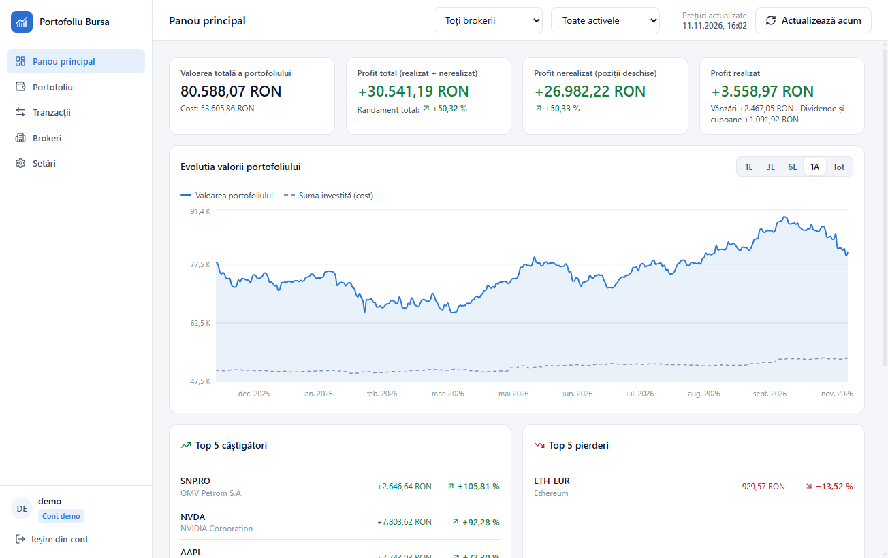
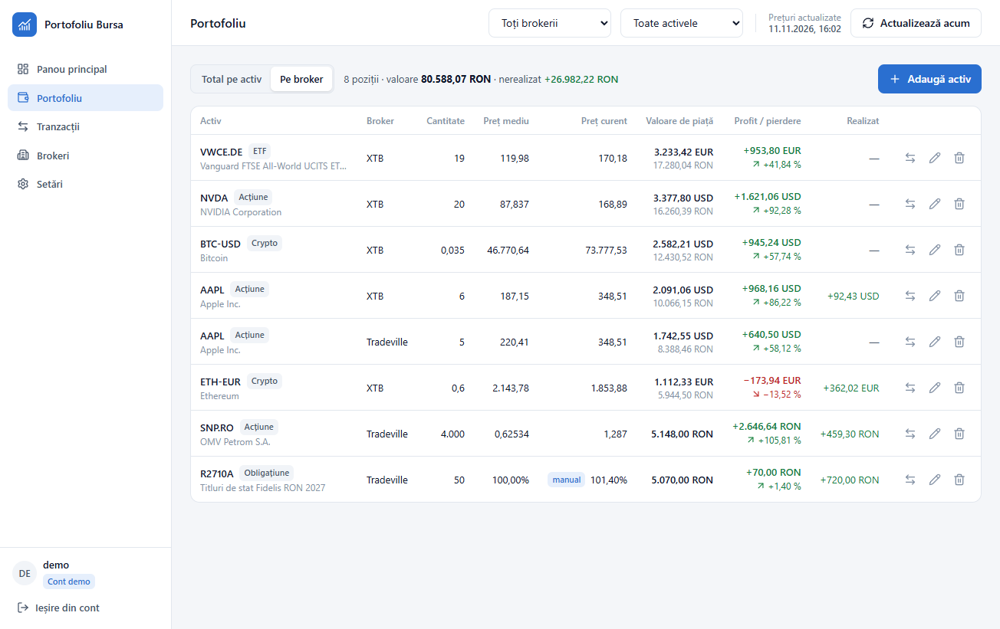
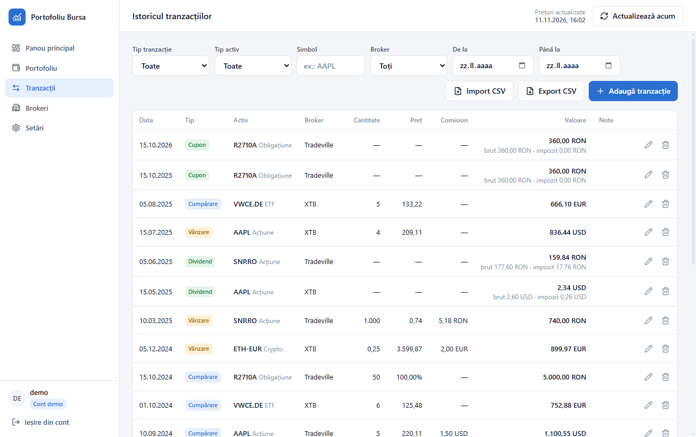
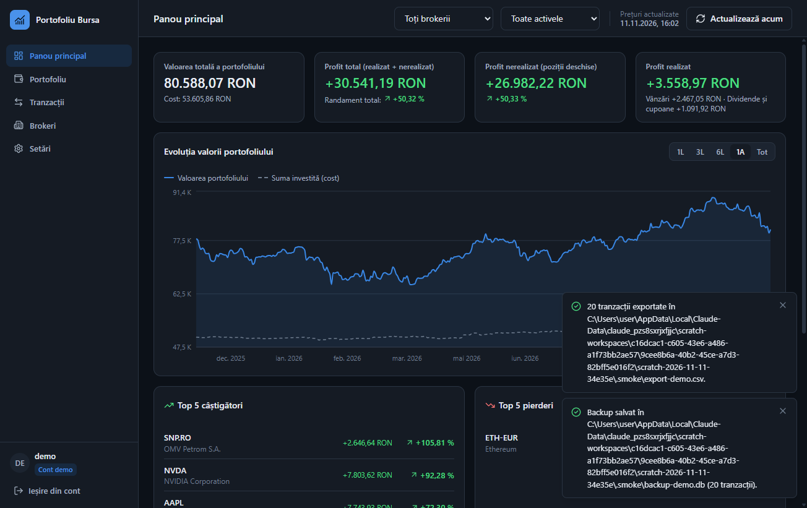

# Portofoliu Bursa

Aplicație desktop pentru monitorizarea investițiilor la bursă: acțiuni, ETF-uri, obligațiuni și crypto, la mai mulți brokeri și în mai multe monede. Datele stau doar pe calculatorul tău, într-o bază de date locală.

- Portofoliu pe total sau pe broker, cu profit realizat și nerealizat
- Istoric de tranzacții: cumpărări, vânzări, dividende, cupoane, split-uri
- Dashboard cu evoluția valorii, alocări și clasamente
- Prețuri actualizate automat (Yahoo Finance, fără cheie; opțional Alpha Vantage, Twelve Data, Polygon)
- Mai mulți utilizatori pe același calculator, fiecare cu datele lui
- Import/export CSV, backup și restaurare, temă luminoasă și întunecată



| Portofoliu pe broker | Istoricul tranzacțiilor | Temă întunecată |
|---|---|---|
|  |  |  |

*Capturile sunt din contul demo (date de test).*

Documentul are două părți: [pentru utilizatori](#partea-1--pentru-utilizatori) și [pentru dezvoltatori](#partea-2--pentru-dezvoltatori).

---

## Partea 1 — Pentru utilizatori

### 1. Descărcare

Intră pe pagina **[Releases](https://github.com/Dariukkk923/portofoliu-bursa/releases/latest)** a proiectului și descarcă fișierul potrivit sistemului tău:

| Sistem | Fișier |
|---|---|
| Windows 10 / 11 | `Portofoliu-Bursa-Setup-<versiune>.exe` |
| macOS cu Apple Silicon (M1, M2, M3, M4) | `Portofoliu-Bursa-<versiune>-mac-arm64.dmg` |
| macOS cu procesor Intel | `Portofoliu-Bursa-<versiune>-mac-x64.dmg` |
| Linux (64 de biți) | `Portofoliu-Bursa-<versiune>-linux-x86_64.AppImage` |

### 2. Instalare

Aplicația **nu este semnată digital** (certificatele costă), așa că Windows și macOS afișează un avertisment la prima pornire. Este de așteptat; pașii de mai jos arată cum treci de el.

#### Windows

1. Deschide fișierul `Portofoliu-Bursa-Setup-….exe`.
2. Apare fereastra albastră **„Windows v-a protejat PC-ul”** (SmartScreen). Apasă **„Mai multe informații”**, apoi **„Rulați oricum”**.
3. Urmează pașii installerului. La final găsești aplicația în meniul Start și pe desktop.

Dacă browserul blochează descărcarea („fișierul nu este descărcat frecvent”), alege **Păstrează** din lista de descărcări.

#### macOS

1. Deschide fișierul `.dmg` și trage **Portofoliu Bursa** în folderul **Applications**.
2. Deschide aplicația. macOS spune că „nu poate fi deschisă deoarece provine de la un dezvoltator neidentificat”. Închide mesajul.
3. Deschide **Configurări sistem → Intimitate și securitate**, derulează până la secțiunea **Securitate** și apasă **„Deschide oricum”** în dreptul aplicației, apoi confirmă. Pe versiunile mai vechi de macOS 15 merge și clic dreapta pe aplicație → **Deschide** → **Deschide**.

Dacă mesajul spune că aplicația „este deteriorată”, deschide **Terminal** și rulează comanda de mai jos, apoi pornește aplicația din nou:

```bash
xattr -cr "/Applications/Portofoliu Bursa.app"
```

#### Linux

```bash
chmod +x Portofoliu-Bursa-*.AppImage
./Portofoliu-Bursa-*.AppImage
```

Dacă apare o eroare despre FUSE, instalează pachetul `libfuse2` (Ubuntu/Debian: `sudo apt install libfuse2`) sau pornește cu `--appimage-extract-and-run`. Dacă apare o eroare despre „sandbox” (pe Ubuntu 24.04 și mai noi), pornește aplicația cu `--no-sandbox`.

### 3. Prima pornire

- Aplicația pornește pe ecranul de autentificare. Alege **Cont nou** și creează un cont (nume, email opțional, parolă de minimum 8 caractere).
- Vrei doar să vezi cum arată? Apasă **Încearcă contul demo**: se deschide un cont cu date de test (acțiuni, un ETF, o obligațiune și crypto, la doi brokeri).
- **„Ține-mă minte”** te păstrează autentificat pe acest calculator timp de 30 de zile.
- Parola se păstrează doar ca hash. **Nu există recuperare de parolă**: aplicația funcționează fără server, deci o parolă uitată nu poate fi resetată. Fă-ți periodic un backup din Setări.

### 4. Cum se folosește

1. **Brokeri** — adaugă brokerii la care ai conturi (XTB, Tradeville, Revolut, Binance etc.). Poți crea unul nou și direct din formularul de achiziție.
2. **Portofoliu → Adaugă activ** — alege tipul, caută simbolul, completează unitățile, prețul, data, brokerul și comisionul. Fiecare achiziție este înregistrată automat ca tranzacție de tip *Cumpărare*.
3. **Tranzacții** — aici adaugi vânzări, dividende, cupoane și split-uri, filtrezi, editezi și ștergi. Aplicația nu te lasă să vinzi mai mult decât deții la acel broker la data respectivă.
4. **Panou principal** — valoarea totală, profitul, evoluția în timp, alocările. Filtrele de broker și de tip de activ din bara de sus se aplică întregului panou.

**Formatul simbolurilor** (cel de pe Yahoo Finance):

| Tip | Exemple |
|---|---|
| Acțiuni SUA | `AAPL`, `MSFT` |
| Bursa de Valori București | sufix `.RO`: `TLV.RO`, `SNP.RO`, `H2O.RO` |
| Alte burse europene | `VWCE.DE` (Xetra), `SAP.DE`, `ASML.AS` |
| Crypto | monedă-valută: `BTC-USD`, `ETH-EUR` |
| Obligațiuni | un cod ales de tine sau simbolul de la bursă (ex.: `R2710A`) |

**Obligațiuni.** Introduci valoarea nominală, rata cuponului, frecvența și scadența. Prețul se exprimă ca **procent din nominal** (100 = la paritate). Titlurile de stat românești nu au preț în API-uri, așa că prețul curent se introduce manual: Portofoliu → iconița creion → *Preț manual*. Încasările se înregistrează ca tranzacții de tip *Cupon*.

**Split-uri.** Adaugă o tranzacție de tip *Split* cu raportul (ex.: `4:1` — patru acțiuni noi pentru una veche). Cantitatea și prețul mediu se ajustează automat, iar valoarea investită rămâne aceeași. Acțiunile gratuite de la BVB se pot înregistra tot ca split (ex.: `115:100`).

**Monede.** Fiecare activ are moneda lui (RON, EUR, USD, GBP, CHF). Totalurile sunt convertite în moneda de bază aleasă în Setări, la cursul curent.

### 5. Prețuri și chei API

Implicit, prețurile vin de la **Yahoo Finance**, fără nicio cheie: acoperă acțiuni, ETF-uri (inclusiv BVB), crypto și cursuri valutare. Nu trebuie să configurezi nimic.

Opțional, în **Setări → Prețuri și provideri de date** poți adăuga alți provideri. Dacă providerul principal dă eroare sau nu are un simbol, aplicația trece automat la următorul. Cheile gratuite se obțin astfel:

| Provider | Cum obții cheia | Limite pe planul gratuit |
|---|---|---|
| Alpha Vantage | <https://www.alphavantage.co/support/#api-key> — completezi formularul și primești cheia pe loc | circa 25 de cereri pe zi |
| Twelve Data | <https://twelvedata.com> — îți faci cont, apoi *Dashboard → API Keys* | 8 cereri pe minut, 800 pe zi |
| Polygon (Massive) | <https://polygon.io> — îți faci cont, apoi *Dashboard → API Keys* | 5 cereri pe minut; doar piața SUA, crypto și valute; preț de închidere din ziua precedentă |

Limitele se pot schimba; verifică pagina fiecărui provider. Cheile sunt salvate criptat pe calculatorul tău, separat pentru fiecare utilizator.

Bine de știut:

- Intervalul de actualizare se alege din Setări (1–60 de minute sau doar manual). Cu un provider cu limite mici, alege un interval mai mare (de exemplu 60 de minute pentru Alpha Vantage).
- Butonul **Actualizează acum** forțează o actualizare; alături este afișată ora ultimei actualizări.
- **Fără internet**, aplicația funcționează cu ultimele prețuri salvate și afișează un avertisment.
- Dacă un activ nu are preț la niciun provider, se folosește ultimul preț introdus manual; dacă nu există nici acela, poziția este evaluată la cost și semnalată.

### 6. Cum se calculează profitul

- **Costul** unei poziții include comisioanele de cumpărare; comisioanele de vânzare scad încasările.
- **Metoda** se alege din Setări: *cost mediu ponderat* (implicit) sau *FIFO*. Ea schimbă doar împărțirea profitului între realizat și nerealizat, nu și totalul.
- **Profit nerealizat** = valoarea de piață a pozițiilor deschise − costul lor.
- **Profit realizat** = profitul din vânzări + dividendele și cupoanele nete (după impozitul reținut).
- **Randament total** = (realizat + nerealizat) / suma tuturor cumpărărilor.
- **Conversia valutară** se face la cursul curent pentru toate sumele, deci câștigul sau pierderea din diferențe de curs nu sunt evidențiate separat.
- La **obligațiuni** se lucrează cu prețul curat: dobânda acumulată nu este inclusă în valoare.
- **Graficul de evoluție** este reconstruit din tranzacții și din prețurile istorice zilnice; pentru activele fără istoric (de exemplu obligațiunile cu preț manual) se folosește costul.

Aplicația este un instrument de evidență, nu de consultanță financiară sau fiscală.

### 7. Import și export CSV

Din pagina **Tranzacții** poți exporta istoricul (respectând filtrele active) și poți importa un fișier CSV. Coloanele (ordinea nu contează; obligatorii sunt `data`, `tip`, `simbol`):

```
data,tip,tip_activ,simbol,nume,broker,cantitate,pret,comision,moneda,suma_bruta,impozit,suma_neta,raport_split,note,valoare_nominala,rata_cupon,frecventa_cupon,data_scadenta
2024-03-04,Cumpărare,Acțiune,SNP.RO,OMV Petrom,Tradeville,5000,0.621,21.7,RON,,,,,,,,,
2024-06-07,Dividend,Acțiune,SNP.RO,,Tradeville,,,,RON,206.5,16.52,189.98,,,,,,
2024-06-10,Split,Acțiune,NVDA,,,,,,USD,,,,10:1,,,,,
```

- `tip`: Cumpărare, Vânzare, Dividend, Cupon, Split (merg și fără diacritice). `tip_activ`: Acțiune, ETF, Obligațiune, Crypto.
- Se acceptă separatorul `,` sau `;`, zecimale cu punct sau virgulă și date în format `AAAA-LL-ZZ` sau `ZZ.LL.AAAA`.
- Brokerii și activele care lipsesc sunt create automat. Pentru un activ nou sunt necesare `tip_activ` și `moneda`.
- Importul este „totul sau nimic”: dacă un rând are o eroare, nu se salvează nimic și primești lista rândurilor de corectat.

Cel mai simplu mod de a obține un model este să exporți tranzacțiile din contul demo.

### 8. Backup și unde stau datele

**Setări → Backup și restaurare** salvează toate datele contului tău (brokeri, active, tranzacții, setări, prețuri) într-un singur fișier și le poate restaura, pe același calculator sau pe altul. Backup-ul nu conține parola și nici cheile API (acestea se reintroduc). Restaurarea înlocuiește datele contului curent; conturile celorlalți utilizatori nu sunt atinse.

Baza de date se află în:

| Sistem | Folder |
|---|---|
| Windows | `%APPDATA%\Portofoliu Bursa\` |
| macOS | `~/Library/Application Support/Portofoliu Bursa/` |
| Linux | `~/.config/Portofoliu Bursa/` |

Dezinstalarea aplicației nu șterge acest folder. Fișierul bazei de date nu este criptat pe disc (parolele sunt hash-uri, iar cheile API sunt criptate): conturile separă datele utilizatorilor în aplicație, dar nu protejează fișierul de cineva care are acces la contul tău de Windows/macOS/Linux.

---

## Partea 2 — Pentru dezvoltatori

### Tehnologii

Electron · React · TypeScript · Vite (electron-vite) · Tailwind CSS · SQLite (better-sqlite3) · Recharts · Vitest · electron-builder.

### Rulare locală

Ai nevoie de **Node.js 22.12 sau mai nou** (recomandat 24) și npm.

```bash
npm install        # instalează dependențele
npm run dev        # pornește aplicația în mod dezvoltare (reîncărcare la cald)
npm test           # rulează testele unitare și de integrare (Vitest)
npm run typecheck  # verifică tipurile (procesul principal + interfața)
npm run build      # typecheck + build de producție în out/
npm start          # pornește build-ul de producție din out/
npm run smoke      # test „de fum” al aplicației construite (capturi în .smoke/)
```

`better-sqlite3` vine cu binare precompilate (N-API) pentru Windows, macOS și Linux, compatibile atât cu Node, cât și cu Electron: nu este nevoie de compilator C++ și nici de `electron-rebuild`. Fișierul `.npmrc` al proiectului dezactivează scripturile de instalare ale dependențelor (`ignore-scripts=true`), pentru că altfel npm ar încerca inutil o compilare cu `node-gyp`, care eșuează pe calculatoarele fără Visual Studio / Xcode.

### Structura proiectului

```
src/
  shared/                 cod comun procesului principal și interfeței (fără Node, fără DOM)
    types.ts              tipurile de date care traversează IPC
    api.ts                contractul API dintre interfață și procesul principal
    calc/                 MODULUL DE CALCUL (pur, testat unitar)
      engine.ts           pozițiile: cost mediu / FIFO, vânzări, split-uri, venituri, validare
      valuation.ts        evaluare la prețul curent, totaluri, alocări, clasamente
      history.ts          reconstrucția evoluției valorii din tranzacții + prețuri istorice
      bonds.ts            cupoane
    csv.ts, dates.ts, labels.ts
  main/                   procesul principal Electron (Node)
    index.ts              pornire, fereastră, meniu
    ipc.ts                sesiunea curentă + handlerele IPC (leagă interfața de servicii)
    db/                   deschiderea bazei și migrările de schemă
    services/             conturi, brokeri, active, tranzacții, portofoliu, setări, CSV, backup, demo
    prices/               provideri de prețuri, cache, serviciul de actualizare
    secrets.ts, electronSecrets.ts   criptarea cheilor API și a tokenului de sesiune
  preload/index.ts        puntea securizată dintre interfață și procesul principal
  renderer/               interfața React (pagini, componente, context)
tests/                    teste Vitest (calcul, servicii pe SQLite în memorie, prețuri, CSV)
scripts/                  test de fum (Playwright) și generatorul de iconiță
.github/workflows/        CI și publicarea installerelor
electron-builder.yml      configurarea împachetării
```

### Arhitectură pe scurt

- **Izolarea utilizatorilor.** Toate tabelele au `user_id`. Interfața nu trimite niciodată id-ul utilizatorului: `main/ipc.ts` ține sesiunea și transmite serviciilor id-ul utilizatorului autentificat, iar fiecare interogare filtrează după el. Există teste care verifică explicit că un utilizator nu poate citi sau modifica datele altuia.
- **Securitate.** Fereastra rulează cu `contextIsolation`, `sandbox` și fără `nodeIntegration`; interfața vede doar `window.bridge` (un apel generic de API + evenimente). Build-ul de producție are Content-Security-Policy. Parolele sunt hash-uri bcrypt (cost 12). Cheile API și tokenul „ține-mă minte” sunt criptate cu `safeStorage` (DPAPI / Keychain / libsecret), cu rezervă AES-256-GCM.
- **Modulul de calcul** (`src/shared/calc`) nu depinde de bază sau de Electron. Pozițiile nu sunt stocate: se recalculează de fiecare dată din tranzacții, deci schimbarea metodei (cost mediu ↔ FIFO) sau editarea unei tranzacții vechi nu lasă date inconsistente.
- **Prețuri.** `prices/provider.ts` definește interfața `PriceProvider` (`getQuote`, `getHistory`, `search`). `prices/service.ts` construiește lanțul de provideri al utilizatorului, cere doar simbolurile al căror cache a expirat, trece la următorul provider la eroare și scrie rezultatele în tabelele `prices` și `price_history`. Aplicația citește mereu din aceste tabele, de aceea funcționează și offline.
  - *Provider nou:* implementează `PriceProvider`, adaugă id-ul în `ProviderId`/`PROVIDER_IDS` (`shared/types.ts`), eticheta în `shared/labels.ts` și construcția lui în `PriceService`.
- **Migrări.** `main/db/migrations.ts` conține lista de migrări, aplicate în ordine la pornire; versiunea se ține în `PRAGMA user_version`. Pentru o schimbare de schemă adaugi o intrare nouă la finalul listei (nu modifici una publicată).

### Teste

`npm test` rulează:

- `tests/engine.test.ts`, `valuation.test.ts`, `history.test.ts` — modulul de calcul: cumpărări multiple, vânzări parțiale (cost mediu și FIFO), split-uri, dividende, cupoane, crypto cu zecimale, mai mulți brokeri, monede diferite, evoluția istorică;
- `tests/services.test.ts` — serviciile pe o bază SQLite în memorie: conturi, izolarea datelor, validări, portofoliu evaluat, CSV, backup/restaurare, contul demo;
- `tests/prices.test.ts` — actualizarea prețurilor cu provideri simulați: rezervă între provideri, cache, mod offline, preț manual.

`npm run smoke` pornește aplicația construită cu un folder de date temporar și parcurge ecranele principale. Cu `SMOKE_EXE="release/win-unpacked/Portofoliu Bursa.exe"` testează aplicația împachetată.

### Crearea unui release nou

Publicarea este automată: workflow-ul `.github/workflows/release.yml` rulează la fiecare tag `v*`, construiește installerele pe Windows, macOS și Linux și le atașează unui release în GitHub Releases.

Prima dată:

1. Creează un repository pe GitHub și urcă proiectul (`git init`, `git add .`, `git commit`, `git remote add origin …`, `git push -u origin main`).
2. Dacă organizația restricționează permisiunile, verifică în *Settings → Actions → General → Workflow permissions* că este permis **Read and write**.

Pentru fiecare versiune:

```bash
npm version 1.0.1          # actualizează versiunea în package.json și creează tagul v1.0.1
git push --follow-tags     # urcă commitul și tagul; workflow-ul pornește singur
```

După câteva minute, installerele apar la `https://github.com/Dariukkk923/portofoliu-bursa/releases`. Linkul `…/releases/latest` duce mereu la ultima versiune — acesta este linkul de trimis utilizatorilor. Workflow-ul verifică faptul că tagul și versiunea din `package.json` coincid și rulează testele înainte de împachetare.

Împachetare locală (doar pentru sistemul pe care rulezi):

```bash
npm run dist:win     # release/Portofoliu-Bursa-Setup-<versiune>.exe
npm run dist:mac     # release/*.dmg (doar pe macOS)
npm run dist:linux   # release/*.AppImage
```

Observații:

- Pe Windows, compilatorul NSIS nu suportă căi mai lungi de 260 de caractere. Ține proiectul într-un folder cu cale scurtă (ex.: `C:\dev\portofoliu-bursa`).
- Installerele **nu sunt semnate**. Pe macOS aplicația primește o semnătură „ad-hoc” (obligatorie pe Apple Silicon), dar tot apare avertismentul Gatekeeper. Pentru a scăpa de avertismente este nevoie de un certificat de semnare Windows, respectiv de un cont Apple Developer cu notarizare; electron-builder le preia din variabilele `CSC_LINK`/`CSC_KEY_PASSWORD` și `APPLE_ID`/`APPLE_APP_SPECIFIC_PASSWORD`/`APPLE_TEAM_ID`, definite ca secrete ale repository-ului.
- Iconița (`build/icon.png`) se regenerează cu `npm run icon`.
